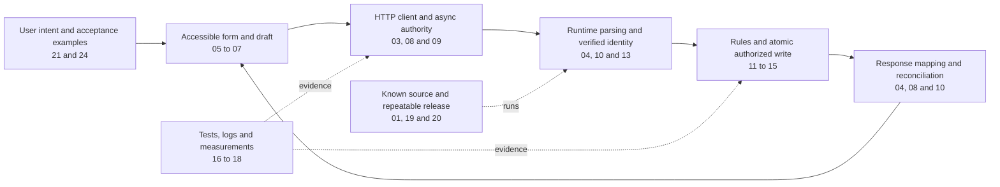

# How the concepts connect

Use this map when a task seems to involve unrelated folders. The same request crosses representations, trust boundaries and lifetimes. Each lesson explains one part of that path.

## Seven questions to carry between lessons

| Question | Why it matters | Connect these lessons |
| --- | --- | --- |
| What is the source of truth? | Avoid derived-state drift and false success | [07](../02-frontend/07-react-state.md), [08](../02-frontend/08-client-server-data.md), [11](../03-backend-data/11-relational-sql.md) |
| Is this a type, representation or verified fact? | TS types, JSON strings and identity claims are different things | [04](../01-foundations/04-typescript.md), [10](../03-backend-data/10-api-architecture.md), [13](../04-security/13-authentication-authorization.md), [22](../07-engineering/22-files-time-integrations.md) |
| Who may act on this resource now? | Ownership, roles, state and revocation affect permission | [12](../03-backend-data/12-migrations-transactions.md), [13](../04-security/13-authentication-authorization.md), [14](../04-security/14-web-security.md) |
| Which result still has authority? | Old callbacks/tokens/cache entries can outlive their context | [03](../01-foundations/03-async-runtime.md), [07](../02-frontend/07-react-state.md), [08](../02-frontend/08-client-server-data.md), [13](../04-security/13-authentication-authorization.md) |
| What can happen between check and use? | A valid earlier read does not make a later unconditional write safe | [10](../03-backend-data/10-api-architecture.md), [12](../03-backend-data/12-migrations-transactions.md), [15](../04-security/15-api-reliability.md) |
| What exactly are we counting or measuring? | Joined rows, requests, timings and test counts have different meaning | [11](../03-backend-data/11-relational-sql.md), [16](../05-quality/16-testing.md), [18](../05-quality/18-performance.md), [23](../07-engineering/23-cs-interviews.md) |
| What evidence supports “done”? | Local code success differs from safe upgrade and hosted delivery | [01](../01-foundations/01-workspace-git.md), [16](../05-quality/16-testing.md), [19](../06-delivery/19-runtime-deployment.md), [24](../07-engineering/24-teamwork-capstone.md) |

## Real change: due dates

The requirement defines a calendar date or instant (21/22). The form captures it accessibly (05/07). The client serializes it without accidental timezone conversion (08/09). The API validates and authorizes (04/10/13). The migration preserves old rows and the query shares the agreed overdue semantics (11/12). The UI reconciles server confirmation (08). Tests fix the clock and check permission/time boundaries (16). A release verifies the new schema and real journey (19/20/24).

If one layer defines “overdue” differently, correct individual functions can still produce an incorrect whole application. This is why full-stack ownership includes contracts and cross-layer tests.

## Retrieval exercise

Without notes, draw the path for an assignment, comment or archive action using your actual files. Mark input, identity, rule, atomic write, response and user recovery. Then pick one failure and identify the first observation that would locate its layer. Repeat with a different feature next week.
